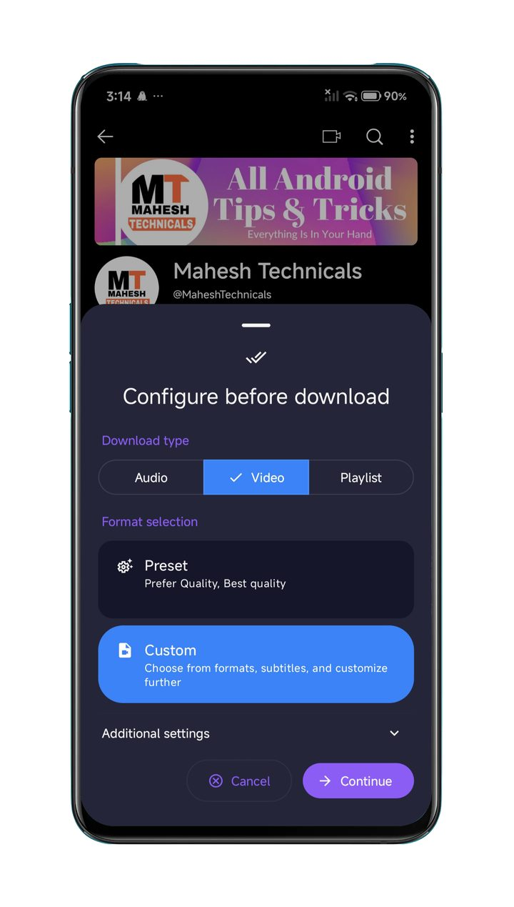
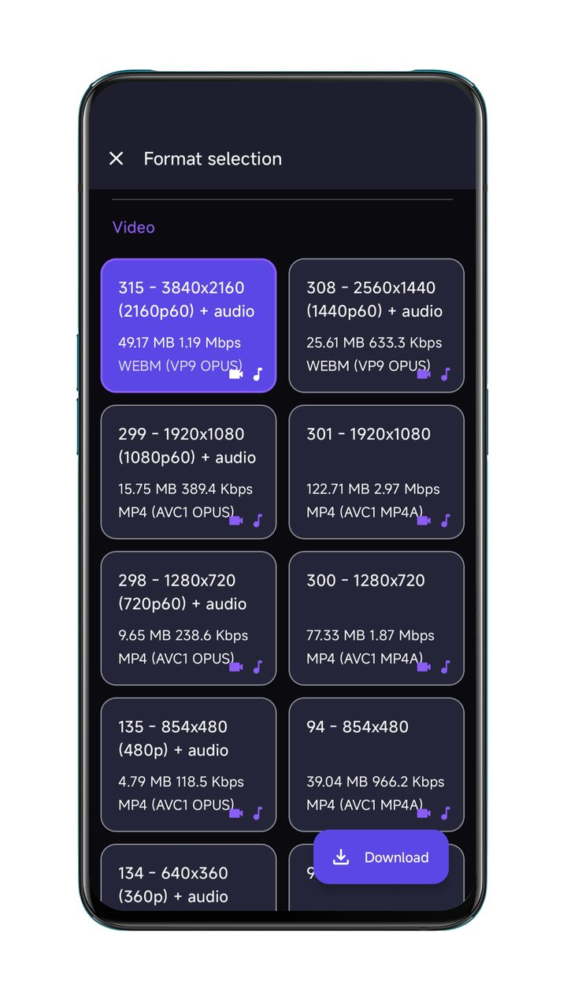
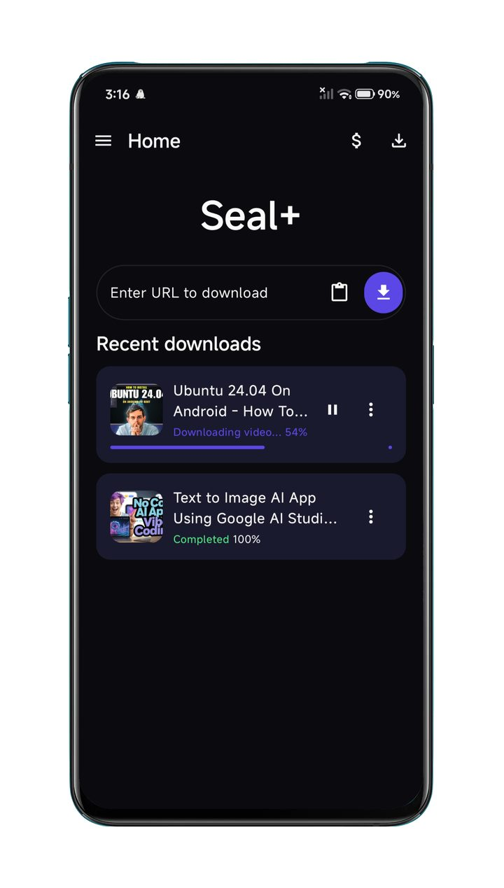

<div align="center">


# Seal Next

### 🎬 The Next-Generation Video & Audio Downloader for Android

**Download anything, beautifully.** Powered by yt-dlp · Crafted with Material You

[](https://github.com/khad3m/Seal-Next/releases/latest)
[](https://github.com/khad3m/Seal-Next/actions/workflows/android.yml)
[](https://github.com/khad3m/Seal-Next/releases)
[](https://github.com/khad3m/Seal-Next/stargazers)
[](LICENSE)
[](https://developer.android.com/about/versions/nougat)

<br>

**Seal Next** is a premium, modern video and audio downloader for Android, built on the
rock-solid [yt-dlp](https://github.com/yt-dlp/yt-dlp) engine. It carries the legacy of
[Seal](https://github.com/JunkFood02/Seal) forward with a refined experience — a full
Material You redesign, smarter downloads, enhanced privacy, and a continuous-release
build pipeline that ships fresh, signed APKs on every commit.

</div>

<br>

## 📱 Screenshots

<div align="center">
<table>
<tr>
<td></td>
<td></td>
<td></td>
</tr>
</table>
</div>

<br>

## ✨ Features

### 🎯 Download Everything
- **1000+ supported sites** — YouTube, Facebook, Instagram, Twitter/X, TikTok, Dailymotion, SoundCloud and every other yt-dlp supported platform
- **Video & audio presets** — one-tap presets for MP4, MKV, MP3, M4A, Opus and more
- **Custom formats** — advanced users can define exact codecs, containers and quality
- **Subtitles & metadata** — grab subtitles (auto-translated too), thumbnails, and video comments
- **Playlist support** — index, selection and merge strategies for whole-channel downloads

### 🔒 Privacy First
- **Private downloads** — keep selected downloads out of gallery scans and your download history
- **App lock** — protect the app with a PIN plus biometric (fingerprint/face) authentication
- **No tracking** — the app collects nothing; your downloads stay on your device

### 🎨 Premium Experience
- **Material You** — dynamic color theming that follows your wallpaper, full dark mode
- **Gradient dark theme** — an exclusive glassmorphism-inspired look
- **Flexible download location** — pick any folder via Storage Access Framework, with per-download overrides
- **In-app update checker** — get notified when a new version of Seal Next ships

### ⚡ Advanced Engine
- **yt-dlp core** — always-on cutting-edge extraction engine
- **aria2c integration** — lightning-fast multi-connection downloads
- **Custom commands** — build, save and run your own yt-dlp command templates, like a terminal in your pocket
- **Reliable queue** — retry all, queue recovery after force-stop, and background wake-lock so long downloads never silently die

<br>

## 🚀 Download & Install

> [!IMPORTANT]
> Google Play is not supported. Download the latest signed APK directly from
> **[GitHub Releases](https://github.com/khad3m/Seal-Next/releases/latest)**.

| File | Best for |
| --- | --- |
| `SealNext-x.y.z-armeabi-v7a.apk` | 📦 **One APK for every phone** — the 32-bit build installs on arm64 devices too (recommended) |

> Since v1.1.0, every release ships a single **armeabi-v7a** APK. It runs on 32-bit phones
> and on 64-bit devices through ARM's native 32-bit compatibility, so one download covers
> everything — smaller, faster to build, easier to share.

**Install steps:**
1. Download the APK from the [Releases](https://github.com/khad3m/Seal-Next/releases/latest) page
2. Open the APK and allow "Install unknown apps" for your browser/file manager if asked
3. Enjoy! 🔥

<br>

## 🛠 Build from Source

Seal Next is built automatically by GitHub Actions on every push to `main` — the workflow
(`.github/workflows/android.yml`) compiles signed release APKs and attaches them to a
GitHub Release. Every APK is signed with the project keystore committed in the repository,
so builds are reproducible and update-compatible.

**Build locally:**
```bash
# Requirements: JDK 21, Android SDK (platform 37.0), Android Studio optional
git clone https://github.com/khad3m/Seal-Next.git
cd Seal-Next
./gradlew assembleGenericRelease      # signed release APKs (universal + per-ABI)
./gradlew assembleGenericDebug        # debug build
```
APKs land in `app/build/outputs/apk/generic/release/`.

<details>
<summary><b>🔧 Tech Stack</b></summary>
<br>

| Layer | Technology |
| --- | --- |
| Language | Kotlin 2.3, JDK 21 toolchain |
| UI | Jetpack Compose (Material 3 / Material You) |
| Architecture | MVVM + Koin dependency injection |
| Storage | Room database + MMKV key-value store |
| Engine | yt-dlp (via youtube-dl-android) + aria2c |
| Build | Gradle 9.5 + AGP 9.2, Kotlin Serialization, KSP |
| CI/CD | GitHub Actions — signed releases on every push |

</details>

<br>

## 🔄 Updating

Seal Next includes an in-app update checker: when a new release is published here on
GitHub, the app notifies you and links you straight to the APK. You can also watch the
repository (★ Watch → Releases only) to get notified yourself.

<br>

## 📋 Changelog

See [CHANGELOG.md](CHANGELOG.md) for what's new in each version.

<br>

## 🤝 Credits & Acknowledgements

Seal Next stands on the shoulders of giants:

- **[Seal](https://github.com/JunkFood02/Seal)** by [JunkFood02](https://github.com/JunkFood02) — the original beautiful yt-dlp GUI for Android
- **[Seal Plus](https://github.com/MaheshTechnicals/Sealplus)** by [Mahesh Technicals](https://github.com/MaheshTechnicals) — the enhanced fork this project continues from
- **[yt-dlp](https://github.com/yt-dlp/yt-dlp)** — the mighty download engine
- **[NewPipe Extractor](https://github.com/TeamNewPipe/NewPipeExtractor)** — site extraction
- **[aria2](https://github.com/aria2/aria2)** — fast parallel downloads
- Every translator and open-source contributor across the ecosystem 🌍

<br>

## 👤 Developer

<div align="center">
<table>
<tr>
<td align="center">
<br/><br/>
<b>Md Khademul Islam</b><br/>
<i>Developer & Maintainer</i><br/><br/>
<a href="https://github.com/khad3m"></a>
</td>
</tr>
</table>
<br>
Seal Next is designed, developed and maintained by <b>Md Khademul Islam</b>.<br>
If you find it useful, please give the repo a ⭐ — it genuinely helps!
</div>

<br>

## ⚖️ License

This project is licensed under the [MIT License](LICENSE) — free to use, modify and share.
Seal Next gratefully builds upon [Seal](https://github.com/JunkFood02/Seal) and
[Seal Plus](https://github.com/MaheshTechnicals/Sealplus); please visit and support those
upstream projects too.

<br>

<div align="center">

**⭐ Star this repository to support Seal Next ⭐**

<sub>Made with ❤️ by Md Khademul Islam · Powered by yt-dlp</sub>

</div>
